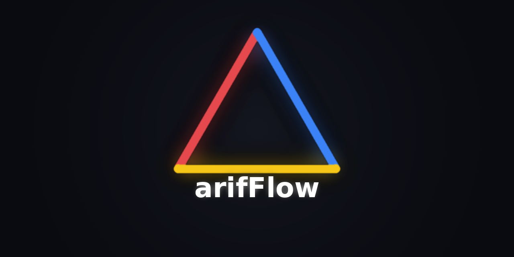

<!-- SOT-MANIFEST
federation_release: v2026.09.13
last_verified: 2026-09-13T06:32:00Z
live_commit: 4d27ede (chore: ignore *.db SQLite runtime artifacts)
apex_zen: A2A delegates ⊥ MCP equips ⊥ ACT mutates ⊥ arifOS governs ⊥ F13 decides
branch_note: HEAD on forge/rg2-lineage-reconcile — not auto-merged to main
organ: arifFlow
role: METABOLISM organ — FQ pulse, receipt metabolism, attention checkpointing
authority: METABOLIZE_ONLY — never judges, never executes
truth_rule: cargo test + curl :7073/health beat any prose below
-->

<p align="center">
  
</p>

# arifFlow

### Metabolism before momentum.

**arifFlow is the arifOS federation's metabolism organ.** A Rust daemon on port `7073` ingests every execute/verify/release receipt in the federation, measures the verify-vs-execute pulse (FQ), and gates new execution when truth-metabolism breaks down.

When intelligence is abundant, momentum becomes the disease: agents execute faster than they verify. arifFlow metabolizes what actually happened — and refuses to let the federation outrun its own evidence.

[30-second proof](#30-second-proof) · [What it does](#what-it-does) · [Current verified state](#current-verified-state) · [Known gaps](#evidence--known-gaps) · [Canon](./ARIFLOW_KERNEL_CANON.md)

[](./.github/workflows/ci.yml)
[](#the-invariant)
[](./Cargo.toml)
[](./SECURITY.md)
[](./LICENSE)

### The invariant

> **It metabolizes. It never judges. It never executes.**
> FQ is a gate, not a verdict — verdict grammar belongs to arifOS. Execution belongs to A-FORGE.

**What arifFlow is not:** not a judge (arifOS judges) · not an executor (A-FORGE executes) · not a memory owner (VAULT999 is arifOS-owned; arifFlow only seals a witness trail) · not a transport layer · not the brain — it is the nerve.

| Audience | What you get |
|---|---|
| **Human** | A pulse for the federation's honesty: are agents verifying what they execute, or drifting into execution dominance? |
| **Agent / A2A** | A check/ingest/release protocol — `POST /check` before execute, `POST /ingest` after, `POST /release` after verify. Held means held |
| **Developer** | A Rust daemon (`cargo build --release`), shell + Python clients, and a JSON health surface to wire into your loop |
| **Auditor** | [Current verified state](#current-verified-state) · [`ARIFLOW_KERNEL_CANON.md`](./ARIFLOW_KERNEL_CANON.md) · [`FLOW_OWNERSHIP_LEDGER.md`](./FLOW_OWNERSHIP_LEDGER.md) · hash-chained receipts |

Live: `https://arifflow.arif-fazil.com/health` · daemon `:7073` · sister organs [arifOS](https://github.com/ariffazil/arifOS) · [A-FORGE](https://github.com/ariffazil/A-FORGE) · [WELL](https://github.com/ariffazil/WELL)

---

## What works today

- **The metabolism daemon is live** — health, ingest, check, release, enforce, flow endpoints on `:7073` (observed 2026-10-16).
- **Chain-aware receipt ingestion** — receipts with an invalid `previous_receipt_hash` are rejected; the receipt stream is tamper-evident by construction.
- **FQ gating with real enforcement** — held actors were observed at probe time; holds, throttles and restricted-actor state are all visible on `/health`.
- **VAULT999 sealing wired into the runtime ingest path** — sealed receipts append to `arifOS/VAULT999/arifflow_sealed.jsonl` as a hash chain (`src/main.rs`, `vault_sealer.seal(...)`). Earlier README text claiming "not wired" was stale and is corrected here (also corrected by the 2026-09-07 FI-008 audit).
- **Auto-enforcement cycle** for the flow-plane invariants, running on an interval in the daemon.

## What is not yet proven

- **BSP scheduler at runtime** — compiled, but invoked only from the `stdin_protocol_loop`, not the daemon path.
- **Cross-organ coordination bridges** (arifOS `:8088`, A-FORGE `:7071`) — compiled, not called from the daemon.
- **Merkle checkpointing at daemon runtime** — computed in the scheduler path only.
- **Gaming-resistance of the FQ formula** — no adversarial evaluation published.
- **Independent audit / stranger reproducibility** — self-measurement and maintainer observation only.

The declared-vs-observed gap is documented, not hidden; resolution is deferred to F13 SOVEREIGN verdict ([Evidence & known gaps](#evidence--known-gaps)).

---

## 30-second proof

One read-only command against the public surface:

```bash
curl -s https://arifflow.arif-fazil.com/health | jq '{verdict, fq: .fq.quotient, actors: .fq.metric_frame.actors_tracked}'
```

Expected shape: `{"verdict": …, "fq": …, "actors": …}` — a top-level flow verdict, the window FQ quotient, and the tracked-actor count. Current values are quoted in [Current verified state](#current-verified-state). On the box itself, `curl -s http://127.0.0.1:7073/health | jq .` returns the full vector.

---

## What it does

arifFlow compresses into four user jobs:

1. **Metabolize receipts.** Every execute, verify and release step across the federation is ingested, hash-linked to the previous receipt, and persisted (`/var/lib/arifflow/receipts.jsonl`).
2. **Measure the FQ pulse.** Per-actor verify-vs-execute quotient plus a seven-dimension vector constellation (the health verdict) — measurement, not interpretation.
3. **Gate execution.** `POST /check` before you execute; the answer is `allowed` or `HOLD`. Risk-weighted `fq_required` per risk class; execution-dominance patterns (consecutive executes without verify) trigger holds. After verifying: `POST /release`.
4. **Enforce flow-plane invariants and seal a witness trail.** F0–F6 auto-enforcement cycles, and sealed receipts appended to the VAULT999 hash chain — flow transmits, never owns memory.

### Agent execution contract (all agents follow this)

```
before execute:  POST /check   {"actor_id": "…"}   → 200 allowed=true | 403 HOLD
after execute:   POST /ingest  {step_type: "Execute", …}
after verify:    POST /ingest  {step_type: "Verify", …}
                 POST /release {"actor_id": "…"}
```

Clients: [`scripts/check.sh`](./scripts/check.sh) (shell) · [`src/py/arifflow/client.py`](./src/py/arifflow/client.py) (Python).

---

## Current verified state

**Observed at: 2026-10-16T09:06:37Z** — method: `curl http://127.0.0.1:7073/health` on the production host.

- Status: `ok-v3-vector` · flow verdict: **FLOWING** (constellation `FLOWING`, fused rank 0.823)
- FQ quotient (window): **1.33** — 57 verify / 43 execute across a 100-receipt sample window
- Actors tracked: **9** · held at probe: `codex`, `fi-002` (both `HELD: FQ=0.00`)
- Invariant counters: 297 enforcement cycles · 900 holds recorded
- Formula: `qg.v0.3.1-vector` (scalar FQ is deprecated as a health indicator — the top-level vector verdict is authoritative)

Dynamic state is generated by probe. If this section conflicts with the live endpoint, the endpoint wins.

---

## Concepts (compressed)

**The FQ gate.** FQ compares verification against execution over a recent receipt window. The scalar quotient is a diagnostic; the **vector constellation** (seven dimensions — FQ, G, J, C_dark, dS, Ω, W3 — each with producer, epistemic class and freshness) is the health verdict. Gates are risk-weighted: each actor carries an `fq_required` per risk class, and consecutive executes without verification trigger a HOLD regardless of the quotient.

**Flow-plane invariants (F0–F6)** — the constitutional ceiling in one line each; full rules in [`ARIFLOW_KERNEL_CANON.md`](./ARIFLOW_KERNEL_CANON.md):

| ID | Rule | ID | Rule |
|---|---|---|---|
| F0 | Transmit, never own | F4 | Route, never execute |
| F1 | Schedule, never authorize | F5 | Receipt, never own memory |
| F2 | Checkpoint, never judge | F6 | Connect, never collapse |
| F3 | Observe, never interpret (auto-enforced) | | |

**Position in the federation.** arifOS is the law (`:8088`) · A-FORGE the hands (`:7071`) · arifFlow the nerve (`:7073`) · FQ the pulse · VAULT999 the structure. Organs call arifFlow through the bridge adapter; no organ imports another to reach the flow engine.

### Endpoints

| Endpoint | Method | Purpose |
|---|---|---|
| `/health` | GET | Status + FQ vector + invariant health + restricted actors |
| `/ingest` | POST | Ingest flow receipt, update actor FQ |
| `/check` | POST | Invariant gate — may this actor execute? |
| `/release` | POST | Release hold after verification |
| `/enforce` | POST | Trigger enforcement cycle manually |

---

## Evidence & known gaps

| Gap | Risk | Status |
|---|---|---|
| BSP scheduler not on the daemon path | The governed parallel-execution design is unexercised at runtime | **Compiled, inactive** — lives in `stdin_protocol_loop` only (observed 2026-08-10 audit) |
| Cross-organ bridges not called | arifOS/A-FORGE coordination is one-way at runtime | **Compiled, inactive** |
| Merkle checkpointing at daemon runtime | Scheduler-path only | **Dead code at daemon runtime** |
| FQ formula gaming-resistance | A determined actor could pad verify receipts | **Open** — no adversarial evaluation published |
| Independent audit | Self-measurement only | **Open** |
| Interpretation of the declared/observed gap | Phased deployment vs deployment drift | **Deferred to F13 SOVEREIGN verdict** — see pre-doctrine archive §"What arifFlow Is at Runtime" |

Detail preserved verbatim: [`docs/archive/README-2026-10-16-pre-doctrine.md`](./docs/archive/README-2026-10-16-pre-doctrine.md) · historical audit: `/root/forge_work/ariflow-audit/` (verdict SABAR — 2 assumptions falsified, 3 weakened).

---

## Development

```bash
git clone https://github.com/ariffazil/arifFLOW.git
cd arifFlow
cargo build --release
cargo test
cargo clippy && cargo fmt

# run the daemon (port via env; production pins ARIFLOW_PORT=7073)
ARIFLOW_PORT=7073 ./target/release/arifflow --daemon

# probe
curl -s http://127.0.0.1:7073/health | jq .vector.diagnosis
```

Prerequisites: Rust 2024 edition (1.85+), Tokio runtime. Release tags are date-stamped `vYYYY.MM.DD` (never semver).

### Operational gates

| Workflow | What it guards |
|---|---|
| [ci](./.github/workflows/ci.yml) | build + test |
| [cargo-lock-invariant](./.github/workflows/cargo-lock-invariant.yml) | `cargo check --locked` on every PR |
| [dependabot-ci](./.github/workflows/dependabot-ci.yml) | unprivileged verdict on Dependabot PRs |
| [auto-merge-dependabot](./.github/workflows/auto-merge-dependabot.yml) | constitutional packages require F13 review (denylist in pre-doctrine archive §CI Governance) |

See [`CONTRIBUTING.md`](./CONTRIBUTING.md).

---

## Security & license

Disclosure policy and threat model: [`SECURITY.md`](./SECURITY.md).

**AGPL-3.0** ([`LICENSE`](./LICENSE)) — when deployed over a network, the complete source code must be made available to all users interacting with the service. Sovereign: **Muhammad Arif bin Fazil** (F13 SOVEREIGN).

---

*Revision 2026-10-16 — restructured under AGENTIC-README-DOCTRINE v1 (attention layer for humans, agents and institutions; dynamic state probed and dated, never hand-carried). Pre-doctrine text preserved verbatim in [`docs/archive/README-2026-10-16-pre-doctrine.md`](./docs/archive/README-2026-10-16-pre-doctrine.md).*

**DITEMPA BUKAN DIBERI** — Forged, Not Given. *Flow observes. arifOS judges. A-FORGE executes. The pulse never commands.*

<!-- FEDERATION-STANDARD v2026-10-15 START :: 333-AGI audit :: source: organs.yaml + git + live probes :: regenerate: re-run audit -->
## 🔗 Federation Identity (auto-audit 2026-10-15)
| Field | Value |
|---|---|
| Organ | `arifflow` · METABOLISM · federation_metabolism |
| Ports | 7073 |
| Unit | arifflow.service |
| Authority ceiling | METABOLIZE_ONLY |
| Live (SOT probe @audit) | UP |
| Repo HEAD @audit | `cf38722 2026-10-15` |
| Public MCP | — |
| Rollback | /opt/arifflow/bin/ROLLBACK.md (3-tier) |
| Flow graph | [FEDERATION.md](https://github.com/ariffazil/AAA/blob/main/FEDERATION.md) — peta semua organ + repo |
<!-- FEDERATION-STANDARD v2026-10-15 END -->
